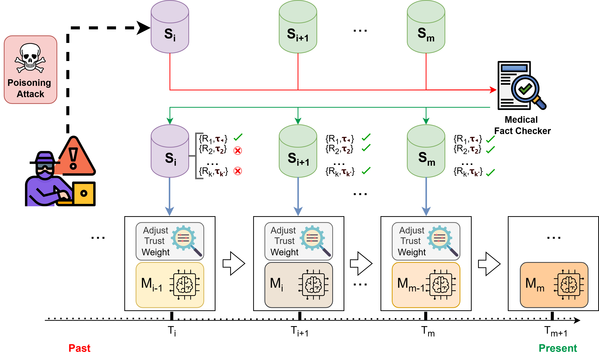

# MedFact-CL: Fact-Checking–Driven Continual Learning for Biomedical Question Answering
MedFact-CL, a methodology that integrates medical fact-checking as an explicit constraint on knowledge retention to regulate how incoming information is preserved over time.
MedFact-CL protects a continually trained biomedical QA model against misinformation in its training stream. Before a sample is used for training, a Graph-RAG fact-checker verifies its context against trusted biomedical evidence and returns a **trust score** τ<sub>x</sub> ∈ [0, 1]. The score then controls how much the sample can change the model, in three continual learning (CL) strategies:

| Strategy | How τ<sub>x</sub> is used |
|---|---|
| **MedFact-EWC** | L = τ̄ · L<sub>task</sub> + (1 − τ̄) · L<sub>EWC</sub>. Low-trust batches are pulled toward consolidated knowledge. The full EWC objective is used when τ̄ ≥ 0.999. |
| **MedFact-Replay** | Only samples with τ<sub>x</sub> ≥ τ<sub>min</sub> = 0.70 can enter the reservoir replay buffer (100 samples). |
| **MedFact-LoRA** | The loss of each sample, and therefore its adapter gradient, is scaled by τ<sub>x</sub>. |

---

## 1. Method overview

<p align="center">
  
</p>

```
 trusted documents ──► SPO extraction ──► UMLS normalization ──► embedding ──► FAISS evidence index (KG)
                                                                                     │
 training sample x ──► SPO extraction ──► UMLS normalization ──► retrieval ◄─────────┘
                                                                     │
                                           PubMedBERT cross-encoder (Supported / Refuted / NEI)
                                                                     │
                                           confidence-weighted fusion ──► τ_x ∈ [0, 1]
                                                                     │
                                       MedFact-EWC / MedFact-Replay / MedFact-LoRA update
```

**Fact-checking module** 

| Step | Implementation | Settings |
|---|---|---|
| Claim extraction | `gemma3:12b` served by Ollama | One call per sentence, with the full segment and the triples already extracted; temperature 0; JSON schema (subject, predicate, object) |
| Entity normalization | ScispaCy `en_core_sci_sm` + UMLS linker | Top-ranked concept; the mention is kept and augmented with the canonical name and CUI |
| Linearization | – | `(m + n : u) P (m + n : u)`, or `(m : u)` when the mention equals the canonical name, or `(m)` without a concept |
| Embedding | `lightonai/modernbert-embed-large` | L2-normalized |
| Evidence index | FAISS exact index (`IndexFlatL2`) | Each entry stores the linearized triple and its trusted source sentence |
| Retrieval | Triple queries + source-sentence queries | Cosine similarity ≥ 0.5 (squared L2 ≤ 1 on unit vectors), top-10 |
| Claim checking | PubMedBERT cross-encoder, trained with [Biomedical-Fact-Checking-framework](https://github.com/phdResearcherDz/Biomedical-Fact-Checking-framework) | 3 classes (SUPPORTED, REFUTED, NOT ENOUGH INFO). |
| Fusion | τ<sub>d</sub> = Σ τ<sub>i</sub> w(y<sub>i</sub>) / Σ τ<sub>i</sub>, w ∈ {+1, 0, −1}; τ<sub>x</sub> = (τ<sub>d</sub> + 1) / 2 | No claim, or NEI-only claims, give the neutral τ<sub>x</sub> = 0.5 |

**Threat model**. In one call, an LLM agent receives the question and the context of a training sample. It returns every evidence sentence of the context, together with the perturbations needed by four attacks:

- **negation injection**: each evidence sentence is negated;
- **factual reversal**: each evidence sentence is contradicted;
- **claim deletion**: all evidence sentences are removed;
- **hallucinated claim injection**: 2–3 fabricated, contradicting sentences are appended.

The perturbations are reintegrated in place, and the label is never changed. For K chronological splits, version v<sub>k</sub> of the stream poisons splits s<sub>1</sub>…s<sub>k</sub> and keeps s<sub>k+1</sub>…s<sub>K</sub> clean.

**Continual learning**. The backbone is `google/flan-t5-xl`. Each sample is a question–context prompt, and the model generates the answer (*yes / no / maybe*). Other settings:

- Inputs are limited to 512 tokens, keeping the first 35 % and the last 65 % of a long context.
- The loss is cross-entropy plus 0.35 × a first-step margin loss (margin 0.20).
- AdamW is used with lr 2.79e-5, batch 8, weight decay 0.166 and warmup 0.189.
- Each split runs for at most 20 epochs, with early stopping on the development loss (patience 3).
- Every configuration is run with 5 seeds (42, 123, 456, 789, 1011).
- After each split, the model is evaluated on the fixed clean test set with accuracy, macro-F1, AUROC and Brier score.

---

## 2. Repository structure

```
MedFact-CL/
├── medfactcl/                    # library
│   ├── utils.py                  # data layout, JSON I/O, sentence splitting, hashing
│   ├── llm.py                    # deterministic JSON generation with Ollama
│   ├── poisoning.py              # semantic poisoning (4 attacks)
│   └── factcheck/
│       ├── extraction.py         # f_LLM : SPO claim extraction
│       ├── normalization.py      # f_norm : UMLS linking + triple linearization
│       ├── index.py              # f_emb + FAISS evidence index
│       ├── decision.py           # f_dec : PubMedBERT cross-encoder
│       ├── fusion.py             # trust score τ_x
│       ├── pipeline.py           # FactChecker (end to end) + claim cache
│       └── components.py         # construction from command-line options
├── scripts/
│   ├── prepare_data.py           # Step 1  splits: check / manifest / rebuild from raw releases
│   ├── poison_data.py            # Step 2  poisoned streams
│   ├── build_evidence_index.py   # Step 4  evidence KG + FAISS index
│   ├── fact_check_streams.py     # Step 5  trust scores → FactCheckedData/
│   ├── run_pipeline.sh           # Steps 1–6
│   └── training/                 # Step 6  continual learning
│       ├── train_naive.py            train_medfact_ewc.py
│       ├── train_ewc.py              train_medfact_replay.py
│       ├── train_replay.py           train_medfact_lora.py
│       ├── train_lora.py             train_baselines.py   (Isolated FT, O-LoRA, BiLoRA, iCaRL, Spectral Signatures)
├── figures/                      # figures used in this README
├── data/                         # preprocessed data
├── results/                      # the results reported
├── requirements.txt
└── environment.yml
```

---

## 3. Installation

The code was developed with Python 3.10, PyTorch 2.7.1 and CUDA 11.8.

```bash
conda env create -f environment.yml
conda activate medfact-cl
pip install torch==2.7.1 --index-url https://download.pytorch.org/whl/cu118   # pick your CUDA build
pip install -r requirements.txt     # also installs the ScispaCy model en_core_sci_sm
```

**LLM server.** Claim extraction and poisoning use a local [Ollama](https://ollama.com) server:

```bash
ollama pull gemma3:12b
ollama serve            # default host http://localhost:11434 (use --ollama_host otherwise)
```

**UMLS linker.** On first use, ScispaCy downloads its UMLS knowledge base (~1 GB) into `~/.scispacy`.

**Hugging Face models** are downloaded automatically on first use:

- `google/flan-t5-xl`
- `lightonai/modernbert-embed-large`
- `microsoft/BiomedNLP-PubMedBERT-base-uncased-abstract-fulltext`

---

## 4. Data

### 4.1 Layout

All scripts read and write `data/` (change it with `--data_dir`):

```
data/
├── BioASQ2025/                      # 12 chronological splits, 1,332 yes/no questions
│   ├── baselines/
│   │   ├── _0_fixed_test/{dev,test}.json         # fixed clean evaluation sets (148 / 82)
│   │   ├── _1_Joint_Data/train.json              # union of the splits (joint training)
│   │   └── _2_Isolate_Data/s1.json … s12.json    # clean chronological splits
│   ├── PoisonedData/
│   │   ├── cache_checkpoint_v2.json              # poisoned context per sample id and attack
│   │   └── _2_Isolate_Data_<attack>_v<k>/s<i>.json
│   ├── FactCheckCache/                           # created by Steps 4–5
│   └── FactCheckedData/                          # created by Step 5, read by the MedFact scripts
└── PubMedQA/                        # 6 chronological splits, 450 PubMedQA-L questions (dev 50 / test 500)
    └── … same structure
```

Every sample is a JSON object:

```json
{"id": "...", "question": "...", "type_question": "yesno", "context": "...", "answer": "yes"}
```

BioASQ samples also have an `evidence` field (the snippet offsets), and PubMedQA samples a `year` field.

### 4.2 Splits

- **BioASQ.** Each split contains only the yes/no questions that are new in its yearly release (set difference of question ids with all previous releases). The context is the concatenation of the question's snippets.
- **PubMedQA-L.** Questions are ordered by publication year.

`python scripts/prepare_data.py check` prints the size and label distribution of every split and verifies that no id is shared by two parts. `python scripts/prepare_data.py manifest` writes the ids and content hashes of every split to `data/manifests/`. With the manifests, `prepare_data.py build` rebuilds the splits from the original BioASQ and PubMedQA releases and verifies every sample against its hash.

### 4.3 Fact-checked streams

`FactCheckedData/` is **not distributed**; it is produced by Step 5. It contains, for every training sample of every stream, the original row plus its `trust_score`:

```
FactCheckedData/Clean_Fact_Checked/s<i>.json                  # clean stream
FactCheckedData/_2_Isolate_Data_<attack>_v<k>/s<i>.json       # poisoned version v_k
```

The MedFact training scripts stop with an error if a trust score is missing.

---

## 5. Reproducing the experiments

Run every command from the repository root. `bash scripts/run_pipeline.sh` runs Steps 1–6 in sequence, once the decision model of Step 3 is in place.

**Step 1: check the splits**
```bash
python scripts/prepare_data.py check
```

**Step 2: poisoned streams.** The released `cache_checkpoint_v2.json` lets you rebuild the released streams without calling the LLM:
```bash
python scripts/poison_data.py --from_cache_only     # rebuild PoisonedData from the cache
python scripts/poison_data.py                       # or generate (missing samples only) with gemma3:12b
```

**Step 3: claim-checking model.** This repository does not train the decision model. We use the PubMedBERT cross-encoder trained with our fact-checking framework, [Biomedical-Fact-Checking-framework](https://github.com/phdResearcherDz/Biomedical-Fact-Checking-framework) (`_3_Decision Making/_1_train_decision_model_claim_level.py`): three classes (SUPPORTED, REFUTED, NOT ENOUGH INFO). Copy the trained model folder (the best checkpoint, with its `config.json` and tokenizer files) to `models/decision_model/`, or pass its path with `--decision_model`.

**Step 4: evidence knowledge graph.** By default, the trusted references are the documents released with each dataset: the PubMed snippets of BioASQ and the PubMed abstracts of PubMedQA, i.e. the clean training contexts. To use another corpus, pass `--reference_file docs.json`, a JSON list of `{"id", "text"}` records.
```bash
python scripts/build_evidence_index.py
```

**Step 5: trust scores.** Each distinct context is verified once, and the verdicts are cached. The run can be interrupted and resumed.
```bash
python scripts/fact_check_streams.py --decision_model models/decision_model
```

**Step 6: continual learning.** Each script runs the clean stream and every poisoned version, for all attacks and 5 seeds, on both datasets.
```bash
python scripts/training/train_naive.py
python scripts/training/train_ewc.py
python scripts/training/train_replay.py
python scripts/training/train_lora.py
python scripts/training/train_medfact_ewc.py
python scripts/training/train_medfact_replay.py
python scripts/training/train_medfact_lora.py
python scripts/training/train_baselines.py --methods isolated_ft o_lora bilora icarl spectral_signatures
```

Useful options of the seven CL scripts (`train_baselines.py` instead takes `--methods`, `--datasets`, `--techniques`, `--seeds`, `--bioasq_versions` and `--pubmedqa_versions`):

| Option | Effect |
|---|---|
| `--datasets BioASQ2025 PubMedQA` | Restrict to a dataset |
| `--mode clean \| poisoned \| all` | Clean stream only, poisoned versions only, or both |
| `--techniques negation_injection …` | Restrict the attacks |
| `--versions 1 2 3` | Restrict the poisoned versions |
| `--seeds 42` | Restrict the seeds |
| `--model_name google/flan-t5-xl` | Backbone |
| `--output_root results/<Method>` | Output folder |
| `--aggregate_only` | Recompute the mean ± std tables from finished runs |
| `--check_clean_trust` | MedFact scripts: report trust-score coverage and stop |

Runs are resumable: finished splits are skipped, and a crashed worker is restarted from the last checkpoint (`--no_supervisor` disables this).

---

## 6. Outputs

```
results/<Method>/<dataset>/
├── clean/ (or clean_factchecked/ for MedFact)/seed_<s>/
│   ├── s<i>/metrics.json          # accuracy, macro-F1, AUROC, Brier on the fixed test set after split i
│   └── all_splits_metrics.json
├── <attack>/seed_<s>/v<k>/…       # same files for every poisoned version
```

The fact-checking step also writes, under `data/<dataset>/FactCheckCache/`:

- `claims.jsonl`: the normalized triples of every passage;
- `verdicts.jsonl`: per passage, the claims, retrieved evidence, class probabilities, τ<sub>d</sub> and τ<sub>x</sub>;
- `trust_summary.json`: the mean trust score per split and stream.

---

## 7. Configuration reference

| Component | Value |
|---|---|
| Backbone | `google/flan-t5-xl` (3B); the paper also reports BioLinkBERT and Qwen2.5 |
| Learning rate / batch / weight decay / warmup | 2.787e-5 / 8 / 0.1657 / 0.1891 (selected with Optuna TPE) |
| Epochs / early stopping | ≤ 20 per split / patience 3 on dev loss |
| Margin loss | margin 0.20, weight 0.35 |
| EWC, MedFact-EWC | λ = 2000, online Fisher decay γ = 0.95, Fisher on 256 samples per split |
| Replay, MedFact-Replay | reservoir buffer of 100, τ<sub>min</sub> = 0.70 |
| LoRA, MedFact-LoRA | r = 16, α = 32, dropout 0.05 on q, v; lr 3e-4; effective batch 8 |
| Poisoning, extraction LLM | `gemma3:12b`, temperature 0 |

---

## 8. Hardware and resources

| Resource | Specification |
|---|---|
| GPU | 2 × NVIDIA RTX 4060 Ti (16 GB each) |
| CPU | 12-core AMD Ryzen |
| RAM | 64 GB |
| Frameworks | PyTorch • Transformers • LangChain • Ollama |
| OS | Ubuntu 22.04 / Windows 11 |
| Avg Runtime | ~1 hours per BioASQ experiment |

---

## 9. Citation

```bibtex
@article{medfactcl2026,
  title   = {MedFact-CL: Fact-Checking-Driven Continual Learning for Biomedical Question Answering},
  journal = {International Journal of Machine Learning and Cybernetics},
  year    = {2026},
  note    = {Under review}
}
```
